  
  
  
  
  

Hi, I'm Glory. I'm a PhD researcher in computer science at Bangor University, funded by the AIMLAC Centre for Doctoral Training.

Many people in England and Wales face a legal problem with no lawyer beside them. They get a letter, a form or a deadline, and no picture of what happens next. I build AI systems that draw that picture: a map of the legal process people can follow. The map shows each legal step, who takes the step, what the step needs, how long the step lasts, and the law behind each rule. Then I test the maps with the people the maps are for.

I have written software since 2015, when I co-founded Qrapp Technology.

## A new paper

**Legal Visualisation in Practice: What LegalVis Reveals About Law**, written with Sarah Nason, was accepted on 25 November 2026 by the *International Review of Law, Computers & Technology* (Taylor & Francis).

In the paper, LegalVis means legal visualisation: the flowcharts, timelines, network maps and other pictures people use to explain legal rules, processes and relationships. The research is spread across legal design, visual law, legal informatics and legal analytics, so we brought it together. We reviewed 51 papers from 2013 to 2025 (a PRISMA review of Scopus, Web of Science and IEEE Xplore) and grouped them into nine clusters. Just over three in four of the papers used 2D pictures, and most of the pictures were made for experts rather than the public.

We then set the papers beside three of our own projects: Artemus, a map of routes to redress in administrative justice in Wales; EmployODR (below); and a Kumu network map of where people find social welfare legal advice. The same problems came back in every kind of legal picture: interpretation, simplification, framing, explanation, evaluation and accountability. These problems come from the law itself, from uncertainty, discretion and contested meaning. A picture does not remove them. A picture makes them easier to see. So we argue that legal visualisation research now needs better evaluation, more work across disciplines, and visual forms that can show legal complexity without hiding how much of the law depends on interpretation.

Once Taylor & Francis publishes the article online, you can read the article at [doi.org/10.1080/13600869.2026.2771561](https://doi.org/10.1080/13600869.2026.2771561).

## What I'm building: LexViz Explorer

[LexViz Explorer](https://lexvizexplorer.com) is the web application at the centre of my PhD. You describe a legal problem in plain words. The AI finds the legal process that fits your problem, and LexViz Explorer draws the legal steps as a map: who does what, in what order, and by which date.

- **One legal step at a time.** The map opens on the step you are at. To see the whole process, click Full journey. Diamonds mark choices. Deadlines are red and carry the word Deadline, so nobody has to rely on colour alone.
- **The law behind every step.** Each statement of law links to the official page the statement is based on. Every 24 hours the system compares each quoted provision with the official text, letter for letter, and keeps every version when the law changes.
- **A person approves each statement of law.** The AI cannot approve one, and an approval counts as independent only when two different people approved the same version.
- **Read aloud.** Every step can be read aloud, and the application works in four languages.

Since autumn 2026 there is a second way in: **a small 3D town in the browser**. You walk or drive to the places where legal problems get sorted out. There is a Housing Centre, a Rights Library, a post office, and a court building with nine courtrooms. Nine story chapters follow real kinds of legal problem: a parking ticket, a damp flat, missing pay, a small claim that ends at a county court hearing, and more. You read the papers, choose what a person does next, and see why each choice is right or wrong under the law. Friends can play a chapter together.

I build LexViz Explorer with React and TypeScript, three.js for the town, Node.js and Express, PostgreSQL and OpenAI models. The code stays in a private repository while the research runs, so here are the numbers instead:

## Other projects

**[EmployODR](https://ogbondaglory.github.io/employodr/)** ([code](https://github.com/OgbondaGlory/employodr)), 2024 to 2025. I built EmployODR for a Regulators' Pioneer Fund project led by the Solicitors Regulation Authority, with the Law Society and the Access to Justice Foundation. You describe a problem at work in your own words. A Python classifier sorts the problem into employment law categories, such as unfair dismissal, discrimination or redundancy. GPT-3.5 Turbo with retrieval (RAG) explains the law, and a network map shows which of eight online dispute resolution tools fit, compared by relevance, cost and accessibility. We tested EmployODR in workshops with employment solicitors, Citizens Advice advisers, law clinic staff and dispute resolution specialists. The Law Society of England and Wales featured EmployODR in a 2025 report on access to justice.

**[PoliViz](https://ogbondaglory.github.io/POLIVIZ/)**. A browser extension and a desktop app for reading privacy policies. PoliViz finds the privacy policy of the website you're on and scores the risks. You see the clauses that matter under the GDPR, and you can ask questions in plain English. Each answer links to the passage of the policy behind the answer. I built PoliViz with GPT-4, a FastAPI backend, sentence-transformer embeddings and FAISS search.

**Earlier visualization work (2023).** I told the story of [refugees resettled in the US from 1975 to 2018](https://github.com/OgbondaGlory/Visualising_USA_Refugee_Regions_Influx_data) as a narrative visualization. I also built [immersive data visualizations that run in the browser](https://github.com/OgbondaGlory/Immersive-Data-Vis-VR), with [A-Frame and WebXR](https://github.com/OgbondaGlory/WebXR-and-A-Frame). The refugee story became a poster at CGVC 2023, and the WebXR tool a CGVC 2023 paper. Both have DOIs, in the list below.

## My research

My thesis has the working title *Drawing the Law as a Process: An Iterative Design Study of AI-Assisted Legal Process Visualization for Access to Justice in England and Wales*. I'm working on four questions:

1. **Evidence.** What does research already show about visualizing legal information for people without legal training, and what is missing?
2. **Design.** What do people with a legal problem, and the advisers who help them, need from a picture of a legal process?
3. **Matching the law.** How can a system that uses large language models show steps that comply with the law of England and Wales, and stay correct when the law changes?
4. **Evaluation.** How should such a system be tested with lay people, advisers and legal experts?

So far I have set out sixteen design requirements, each linked to evidence. I also traced how the design changed over fifteen months of prototypes. I grouped 1,539 screenshots into thirteen versions, and followed 28 ideas from the first sketch to the point where I kept, changed or dropped each one. Next come two studies. In a co-design study, people draw their own explanation of a legal process before they see mine. In the evaluation, I measure the quality of people's decisions, how well people understand conditions and exceptions, and how closely people's trust in the tool matches the accuracy of the tool. Both studies are waiting for ethics approval.

## Papers and talks

**Journal**

- **Legal Visualisation in Practice: What LegalVis Reveals About Law.** With S. Nason. *International Review of Law, Computers & Technology*, accepted 25 November 2026. [doi:10.1080/13600869.2026.2771561](https://doi.org/10.1080/13600869.2026.2771561)

**Conferences and posters**

- **Explanatory Visualization with LLMs for Employment Law.** E. G. Ogbonda, S. Nason, J. C. Roberts and P. W. S. Butcher. Poster, IEEE VIS 2025, Vienna. [Paper on Bangor's research portal](https://pure.bangor.ac.uk/ws/portalfiles/portal/83308386/IEEE_VIS_2025_Poster_Paper_Explainable_Vis_for_Law_with_AI.pdf)
- **Harnessing Generative AI to Enhance Access to Online Dispute Resolution in Employment Law.** S. Nason, E. G. Ogbonda, J. C. Roberts and P. W. S. Butcher. Workshop on AI for Access to Justice, ICAIL 2025, Chicago, 20 June 2025. [Paper](https://ebubegloryogbonda.online/assets/docs/Harnessing-Generative-AI-ODR.pdf), and the [workshop write-up by the Stanford Legal Design Lab](https://justiceinnovation.law.stanford.edu/human-centered-ai-at-icails-access-to-justice-workshop)
- **Crafting Visual Narratives: A Case Study on Developing an Engaging Visualisation Poster Using U.S. Immigration Data.** E. G. Ogbonda, P. W. S. Butcher and J. C. Roberts. Computer Graphics and Visual Computing (CGVC) 2023. [doi:10.2312/CGVC.20231203](https://doi.org/10.2312/CGVC.20231203)
- **Interweaving Data and Stories: A Case Study on Unveiling the Human Dimension of U.S. Refugee Movements through Narrative Visualisation.** E. G. Ogbonda, J. C. Roberts and P. W. S. Butcher. Poster, CGVC 2023. [doi:10.2312/CGVC.20231192](https://doi.org/10.2312/CGVC.20231192)
- **Immersive WebXR Data Visualisation Tool.** E. G. Ogbonda. CGVC 2023. [doi:10.2312/CGVC.20231202](https://doi.org/10.2312/CGVC.20231202)

**Policy and reports**

- **Bangor University response to the Online Procedure Rule Committee.** E. G. Ogbonda, S. Nason, J. C. Roberts and P. W. S. Butcher, 2025. [PDF](https://ebubegloryogbonda.online/assets/docs/OPRC-Consultation-Response.pdf)
- **Written evidence submitted by the Bangor University Access to Justice and Law and Technology Research Groups** (ATJ0121), 2025.
- **21st Century Justice, final report.** The Law Society of England and Wales, June 2025. The report features EmployODR.

**Talks**

- **Opportunities and Impact for Visualization across Law and Judicial Processes.** With J. C. Roberts, S. Nason and P. W. S. Butcher. Turing Connections, University of Liverpool (May 2024), and the AI Conference, Swansea University (June 2024).

Two more papers are under review. The full list is on [my website](https://ebubegloryogbonda.online/publications.php) and [ORCID](https://orcid.org/0009-0002-9781-7537).

## My last 12 months on GitHub

## What I build with

## Teaching and work

- **Teaching assistant**, School of Computer Science and Engineering, Bangor University (since January 2024). I help run the lab sessions of the Machine Learning and Advanced Machine Learning modules (ICE-3703 and ICE-4702).
- **AI researcher**, Solicitors Regulation Authority (May 2024 to February 2025, contract). I built EmployODR.
- **International Recruitment Officer**, Bangor University (since April 2025). I help international applicants with admissions, CAS letters and visas.
- **Lead software developer**, Tawa Online (part-time, since November 2023).
- **Student Ambassador**, Bangor University (since February 2024). Campus tours and open days.
- **Co-founder and data scientist**, Qrapp Technology Ltd (since 2015). Data tools for small businesses.

## Education

- **PhD in Computer Science**, Bangor University, funded by the AIMLAC Centre for Doctoral Training (2023 to 2027).
- **Visiting postgraduate researcher**, School of Physics, University of Bristol, as part of AIMLAC (October 2023 to September 2024). Distinction.
- **Certificates**: NITDA Machine Learning Professional; IBM Data Science Professional Certificate; IBM Data Analyst Professional Certificate; Applied Data Science Specialization; Data Visualization and Dashboard Essentials (all 2023, [on Credly](https://www.credly.com/users/ebube_glory_ogbonda/badges)).

  Away from the keyboard: powerlifting and judo. 
  

The pictures on this page are drawn by <a href="scripts/build.mjs">scripts/build.mjs</a> in the LexViz paper style, with Lexend and Caveat (SIL Open Font License). The activity calendar is drawn again every day by a GitHub Action.
