  
  
  
  
  

Hi, I'm Glory. I'm a PhD researcher in computer science at Bangor University, in the AIMLAC Centre for Doctoral Training.

Many people in England and Wales face a legal problem with no lawyer beside them. They get a letter, a form or a deadline, and no picture of what happens next. My research is about that picture. I draw legal processes as maps: each legal step, who takes the step, what the step needs, how long the step lasts, and the law behind each rule. Then I test the maps with the people they are for.

I also build what I study, from the database to the last button. I have written software since 2015, when I co-founded Qrapp Technology.

## A new paper

**Legal Visualisation in Practice: What LegalVis Reveals About Law**, written with Sarah Nason, was accepted on 25 November 2026 by the *International Review of Law, Computers & Technology* (Taylor & Francis). LegalVis is a published visual analytics tool for exploring how court decisions cite earlier ones (Resck et al., 2023).

DOI: [10.1080/13600869.2026.2771561](https://doi.org/10.1080/13600869.2026.2771561). The link will work once Taylor & Francis publishes the article online.

## What I'm building: LexViz Explorer

[LexViz Explorer](https://lexvizexplorer.com) is the web application at the centre of my PhD. You describe a legal problem in plain words, and LexViz Explorer shows the legal steps as a map: who does what, in what order, and by which date.

- **One legal step at a time.** To see the whole process, you click Full journey. Diamonds mark choices. Deadlines are red and carry the word Deadline, so nobody has to rely on colour alone.
- **The law behind every step.** Each statement of law links to the official page the statement is based on. Every 24 hours the system compares each quoted provision with the official text, letter for letter, and keeps every version when the law changes.
- **A person approves each statement of law.** The AI cannot approve one, and an approval counts as independent only when two different people approved the same version.
- **Read aloud.** Every step can be read aloud, and the application works in four languages.

Since autumn 2026 there is a second way in: **a small 3D town in the browser**. You walk or drive to the places where legal problems get sorted out. There is a Housing Centre, a Rights Library, a post office, and a court building with nine courtrooms. Nine story chapters follow real kinds of legal problem: a parking ticket, a damp flat, missing pay, a small claim that ends at a county court hearing, and more. You read the papers, choose what a person does next, and see why each choice is right or wrong under the law. Friends can play a chapter together.

I build LexViz Explorer with React and TypeScript, three.js for the town, Node.js and Express, PostgreSQL and OpenAI models. The code is in a private repository while the research runs, so here is what the code looks like from the outside:

## Other projects

**[EmployODR](https://ogbondaglory.github.io/employodr/)** ([code](https://github.com/OgbondaGlory/employodr)), 2024 to 2025. I built EmployODR for the Solicitors Regulation Authority, with funding from the Regulators' Pioneer Fund. You describe a problem at work, and EmployODR explains the employment law of England and Wales that applies, then suggests online dispute resolution services, scored for relevance, cost and accessibility. EmployODR uses GPT-3.5 Turbo with retrieval from employment law sources. The Law Society of England and Wales featured EmployODR in a 2025 report on access to justice.

**[PoliViz](https://ogbondaglory.github.io/POLIVIZ/)**. A browser extension and a desktop app for reading privacy policies. PoliViz finds the privacy policy of the website you're on and scores the risks. You see the clauses that matter under the GDPR, and you can ask questions in plain English. Each answer links to the passage of the policy behind the answer. I built PoliViz with GPT-4, a FastAPI backend, sentence-transformer embeddings and FAISS search.

**Earlier visualization work (2023).** [Refugee movements to the US from 1975](https://github.com/OgbondaGlory/Visualising_USA_Refugee_Regions_Influx_data) as a narrative visualization, and [immersive data visualization in the browser](https://github.com/OgbondaGlory/Immersive-Data-Vis-VR) with [A-Frame and WebXR](https://github.com/OgbondaGlory/WebXR-and-A-Frame). Both became posters in the Eurographics Digital Library.

## My research

My thesis has the working title *Drawing the Law as a Process: An Iterative Design Study of AI-Assisted Legal Process Visualization for Access to Justice in England and Wales*. I'm working on four questions:

1. **Evidence.** What does research already show about visualizing legal information for people without legal training, and what is missing?
2. **Design.** What do people with a legal problem, and the advisers who help them, need from a picture of a legal process?
3. **Matching the law.** How can a system that uses large language models show steps that comply with the law of England and Wales, and stay correct when the law changes?
4. **Evaluation.** How should such a system be tested with lay people, advisers and legal experts?

So far I have set out sixteen design requirements, each linked to evidence. I also traced how the design changed over fifteen months of prototypes. I grouped 1,539 screenshots into thirteen versions, and followed 28 ideas from the first sketch to the version that kept or dropped each idea. Next come two studies. In a co-design study, people draw their own explanation of a legal process before they see mine. In the evaluation, I measure the quality of people's decisions, how well people understand conditions and exceptions, and how closely people's trust in the tool matches the accuracy of the tool. Both studies are waiting for ethics approval.

## Papers and talks

| Year | Where | What |
|---|---|---|
| 2026 | *International Review of Law, Computers & Technology* | **Legal Visualisation in Practice: What LegalVis Reveals About Law**, with S. Nason. Accepted 25 November 2026. [doi:10.1080/13600869.2026.2771561](https://doi.org/10.1080/13600869.2026.2771561) |
| 2025 | IEEE VIS | **Explanatory Visualization with LLMs for Employment Law** |
| 2025 | ICAIL 2025, Workshop on AI for Access to Justice, Chicago | **Harnessing Generative AI to Enhance Access to Online Dispute Resolution in Employment Law**, E. G. Ogbonda and S. Nason. [Workshop write-up by the Stanford Legal Design Lab](https://justiceinnovation.law.stanford.edu/human-centered-ai-at-icails-access-to-justice-workshop) |
| 2025 | The Law Society of England and Wales | The *21st Century Justice* report features EmployODR |
| 2024 | Turing Connections, University of Liverpool (May); AI Conference, Swansea University (June) | Talk: **Opportunities and Impact for Visualization across Law and Judicial Processes**, with J. C. Roberts, S. Nason and P. W. S. Butcher |
| 2023 | Eurographics Digital Library | Three posters: US immigration data; US refugee movements as a narrative visualization; an immersive WebXR data visualization tool (A-Frame and D3.js) |

Two more papers are under review.

## My last 12 months on GitHub

## What I build with

## Teaching and work

- **Teaching assistant**, School of Computer Science and Engineering, Bangor University (since January 2024). I demonstrate in the Machine Learning and Advanced Machine Learning modules (ICE-3703 and ICE-4702).
- **AI researcher**, Solicitors Regulation Authority (May 2024 to February 2025, contract). I built EmployODR.
- **International Recruitment Officer**, Bangor University (since April 2025). I help international applicants with admissions, CAS letters and visas.
- **Lead software developer**, Tawa Online (part-time, since November 2023).
- **Student Ambassador**, Bangor University (since February 2024). Campus tours and open days.
- **Co-founder and data scientist**, Qrapp Technology Ltd (since 2015). Data tools for small businesses.

## Education

- **PhD in Computer Science**, Bangor University, AIMLAC CDT (2023 to 2027).
- **Visiting postgraduate researcher**, School of Physics, University of Bristol, as part of AIMLAC (October 2023 to September 2024). Distinction.
- **Certificates**: NITDA Machine Learning Professional; IBM Data Science Professional Certificate; IBM Data Analyst Professional Certificate; Applied Data Science Specialization; Data Visualization and Dashboard Essentials (all 2023, [on Credly](https://www.credly.com/users/ebube_glory_ogbonda/badges)).

  Away from the keyboard: powerlifting and judo. 
  

The pictures on this page are drawn by <a href="scripts/build.mjs">scripts/build.mjs</a> in the LexViz paper style, with Lexend and Caveat (SIL Open Font License). The activity calendar is drawn again every day by a GitHub Action.
