  
  
  
  
  

Hi, I'm Glory. I'm a PhD researcher in computer science at Bangor University, funded by the AIMLAC Centre for Doctoral Training.

Many people in England and Wales encounter legal problems without legal representation. They may receive correspondence, be asked to complete a form, or need to meet a deadline without knowing how the legal process proceeds. I develop artificial intelligence systems that generate procedural maps to help people navigate these processes. For each step, the maps identify the responsible actor, specify the requirements and expected duration, and cite the legal basis for the applicable rules. I then evaluate the maps with their intended users.

In 2015 I co-founded Qrapp Technology Ltd, where I continue to develop data-driven software products for small and medium-sized enterprises, from requirements to deployment.

## New publication

**Legal Visualisation in Practice: What LegalVis Reveals About Law**, co-authored with Sarah Nason, was accepted for publication in the *International Review of Law, Computers & Technology* (Taylor & Francis) on 25 November 2026.

The article examines legal visualisation (LegalVis): the use of flowcharts, timelines, network maps and other visual forms to explain legal rules, processes and relationships. Research in this area is spread across legal design, visual law, legal informatics and legal analytics. We conducted a systematic review following PRISMA 2020 across Scopus, Web of Science and IEEE Xplore (2013 to 2025), selected 51 papers, and identified nine clusters through cluster analysis. Just over three quarters of the reviewed studies used 2D visualisations, and most were designed for expert users rather than the public.

We then compared the literature with three of our own projects: Artemus, which visualises routes to redress in the bilingual administrative justice systems of Wales; EmployODR; and a Kumu network map of social welfare legal advice. The same challenges recurred across every form of LegalVis: interpretation, simplification, framing, explanation, evaluation and accountability. These challenges reflect enduring characteristics of law, including uncertainty, discretion and contestability. Visualisation does not resolve them, but it makes them more visible. We conclude that future LegalVis research should give greater attention to evaluation and interdisciplinary collaboration, and should develop visual forms that represent legal complexity without obscuring the interpretive nature of law.

The published version will be available at [doi.org/10.1080/13600869.2026.2771561](https://doi.org/10.1080/13600869.2026.2771561).

## Current project: LexViz Explorer

[LexViz Explorer](https://lexvizexplorer.com) is the web application at the centre of my doctoral research. A user describes a legal problem in plain language. The system identifies the applicable legal process and presents the legal steps as a map that shows who acts, in what order, and by which deadline.

- **Progressive disclosure.** The map opens on the user's current step, and the Full journey view displays the complete process. Diamonds represent decision points. Deadlines are shown in red with the label "Deadline", so that colour is not the only cue.
- **Traceable legal sources.** Each statement of law links to the official source on which the statement is based. Every 24 hours, the system compares each quoted provision with the official text, character by character, and retains every version when the law changes.
- **Human approval of legal content.** Only a person can approve a statement of law. An approval counts as independent only when two different reviewers have approved the same version.
- **Accessibility.** Every step can be read aloud, and the application is available in four languages.

Since autumn 2026, LexViz Explorer has also offered a second mode: a 3D game that runs in a browser. Users walk or drive to the places where legal problems are resolved, including a Housing Centre, a Rights Library, a post office and a court building with nine courtrooms. I developed nine story chapters in the game that are based on common types of legal problems, such as a parking ticket, a damp flat, unpaid wages, and a small claim that proceeds to a county court hearing. In each chapter, users read the documents, decide what a character should do next, and see why each choice is or is not supported by the law. Chapters can also be played together with friends.

LexViz Explorer is built with React and TypeScript, three.js for the 3D town, Node.js and Express, PostgreSQL, and OpenAI models. The source code remains in a private repository while the research is ongoing. The figure below summarises the codebase.

## Other projects

**[EmployODR](https://ogbondaglory.github.io/employodr/)** ([code](https://github.com/OgbondaGlory/employodr)), 2024 to 2025. I developed EmployODR as part of a Regulators' Pioneer Fund project led by the Solicitors Regulation Authority, with the Law Society and the Access to Justice Foundation. Users describe an employment problem in their own words. A Python classifier assigns the problem to employment law categories such as unfair dismissal, discrimination or redundancy. GPT-3.5 Turbo with retrieval-augmented generation (RAG) explains the relevant law, and a network visualisation shows which of eight online dispute resolution tools are suitable, compared by relevance, cost and accessibility. We evaluated EmployODR in workshops with employment solicitors, Citizens Advice advisers, law clinic staff and dispute resolution specialists.

The Law Society of England and Wales describes EmployODR in the [*21st Century Justice: Final Report*](https://www.lawsociety.org.uk/21cj-final-report-june-25) (June 2025, pages 12 and 13), without using the name, as the employment law tool developed with Bangor University that "used generative AI to assess a person's legal needs and then signpost to online dispute resolution options ranked by suitability". Employment law experts who tested the tool found "a high degree of accuracy in assessing the potential legal issues at play". The report notes that the tool was built "in less than six months by a small team of academics at Bangor, with most of the work being carried out by a single PhD student", and cites "the potential demonstrated by the AI-powered employment law tool to increase access to justice at a low cost" in recommending that the Ministry of Justice support a government-backed solutions explorer.

**[PoliViz](https://ogbondaglory.github.io/POLIVIZ/)**. A browser extension and desktop application that helps users understand privacy policies. PoliViz detects the privacy policy of the current website, scores potential risks, highlights the clauses relevant under the GDPR, and answers questions in plain English. Each answer links to the passage of the policy on which the answer is based. PoliViz uses GPT-4, a FastAPI backend, sentence-transformer embeddings and FAISS search.

**Earlier visualisation work (2023).** A narrative visualisation of [refugees resettled in the US from 1975 to 2018](https://github.com/OgbondaGlory/Visualising_USA_Refugee_Regions_Influx_data), and [immersive data visualisations for the web](https://github.com/OgbondaGlory/Immersive-Data-Vis-VR) built with [A-Frame and WebXR](https://github.com/OgbondaGlory/WebXR-and-A-Frame). This work led to one poster and two short papers at Computer Graphics and Visual Computing (CGVC) 2023, listed below.

## Doctoral research

My thesis, provisionally titled *Drawing the Law as a Process: An Iterative Design Study of AI-Assisted Legal Process Visualization for Access to Justice in England and Wales*, addresses four research questions:

1. **Evidence.** What does existing research show about visualising legal information and legal processes for people without legal training, how was that work tested, and what is missing?
2. **Design.** What do lay people, and the professionals who advise them, need from a visual illustration of a legal process, and which visual and interaction designs meet those needs?
3. **Matching the law.** How can a system that uses large language models show people steps that comply with the law of England and Wales, and keep the steps compliant when the law changes?
4. **Evaluation.** How should such a system be tested with lay people, advisers and legal experts, and what does the evidence gathered so far show?

To date, I have established sixteen design requirements, each supported by evidence, and documented how the design evolved over fifteen months of prototyping. I organised 1,539 screenshots into thirteen versions and traced 28 design ideas from their first appearance to the point at which each idea was kept, changed or dropped. Two studies are planned. In a co-design study, participants draw their own explanation of a legal process before seeing any example, so that their ideas are not shaped by my designs. The evaluation will measure the quality of participants' decisions, their understanding of conditions and exceptions, and how closely their trust in the tool matches the accuracy of the tool. Both studies are awaiting ethics approval.

## Publications and talks

**Journal**

- **Legal Visualisation in Practice: What LegalVis Reveals About Law.** With S. Nason. *International Review of Law, Computers & Technology*, accepted 25 November 2026. [doi:10.1080/13600869.2026.2771561](https://doi.org/10.1080/13600869.2026.2771561)

**Conference papers and posters**

- **Explanatory Visualization with LLMs for Employment Law.** E. G. Ogbonda, S. Nason, J. C. Roberts and P. W. S. Butcher. Poster, IEEE VIS 2025, Vienna. [Paper on Bangor's research portal](https://pure.bangor.ac.uk/ws/portalfiles/portal/83308386/IEEE_VIS_2025_Poster_Paper_Explainable_Vis_for_Law_with_AI.pdf)
- **Harnessing Generative AI to Enhance Access to Online Dispute Resolution in Employment Law.** S. Nason, E. G. Ogbonda, J. C. Roberts and P. W. S. Butcher. Workshop on AI for Access to Justice, ICAIL 2025, Chicago, 20 June 2025. [Paper](https://ebubegloryogbonda.online/assets/docs/Harnessing-Generative-AI-ODR.pdf); [workshop report by the Stanford Legal Design Lab](https://justiceinnovation.law.stanford.edu/human-centered-ai-at-icails-access-to-justice-workshop)
- **Crafting Visual Narratives: A Case Study on Developing an Engaging Visualisation Poster Using U.S. Immigration Data.** E. G. Ogbonda, P. W. S. Butcher and J. C. Roberts. Short paper, Computer Graphics and Visual Computing (CGVC) 2023. [doi:10.2312/CGVC.20231203](https://doi.org/10.2312/CGVC.20231203)
- **Interweaving Data and Stories: A Case Study on Unveiling the Human Dimension of U.S. Refugee Movements through Narrative Visualisation.** E. G. Ogbonda, J. C. Roberts and P. W. S. Butcher. Poster, CGVC 2023. [doi:10.2312/CGVC.20231192](https://doi.org/10.2312/CGVC.20231192)
- **Immersive WebXR Data Visualisation Tool.** E. G. Ogbonda. Short paper, CGVC 2023. [doi:10.2312/CGVC.20231202](https://doi.org/10.2312/CGVC.20231202)

**Policy and reports**

- **Bangor University response to the Online Procedure Rule Committee.** E. G. Ogbonda, S. Nason, J. C. Roberts and P. W. S. Butcher, 2025. [PDF](https://ebubegloryogbonda.online/assets/docs/OPRC-Consultation-Response.pdf)
- **Written evidence submitted by the Bangor University Access to Justice and Law and Technology Research Groups** (ATJ0121), 2025.
- **21st Century Justice: Final Report.** The Law Society of England and Wales, June 2025. EmployODR is described on pages 12 and 13, in the section "One trusted entry point for those with a legal need and safer online dispute resolution". [Report (PDF)](https://www.lawsociety.org.uk/21cj-final-report-june-25)

**Talks**

- **Opportunities and Impact for Visualization across Law and Judicial Processes.** With J. C. Roberts, S. Nason and P. W. S. Butcher. Turing Connections, University of Liverpool (May 2024), and the AI Conference, Swansea University (June 2024).

Two further papers are under review. The complete list is on [my website](https://ebubegloryogbonda.online/publications.php) and [ORCID](https://orcid.org/0009-0002-9781-7537).

## My last 12 months on GitHub

## What I build with

## Teaching and work

- **Teaching assistant**, School of Computer Science and Engineering, Bangor University (since January 2024). I support laboratory sessions for the Machine Learning and Advanced Machine Learning modules (ICE-3703 and ICE-4702).
- **AI researcher**, Solicitors Regulation Authority (May 2024 to February 2025, contract). I developed EmployODR.
- **International Recruitment Officer**, Bangor University (since April 2025). I advise international applicants on admissions, CAS letters and visas.
- **Lead software developer**, Tawa Online (part-time, since November 2023).
- **Student Ambassador**, Bangor University (since February 2024). I lead campus tours and support open days.
- **Co-founder and data scientist**, Qrapp Technology Ltd (since 2015). Data-driven software products for small and medium-sized enterprises.

## Education

- **PhD in Computer Science**, Bangor University, funded by the AIMLAC Centre for Doctoral Training (2023 to 2027).
- **Visiting postgraduate researcher**, School of Physics, University of Bristol, as part of AIMLAC (October 2023 to September 2024). Distinction.
- **Certificates**: NITDA Machine Learning Professional; IBM Data Science Professional Certificate; IBM Data Analyst Professional Certificate; Applied Data Science Specialization; Data Visualization and Dashboard Essentials (all 2023, [on Credly](https://www.credly.com/users/ebube_glory_ogbonda/badges)).

  Outside research: powerlifting and judo. 
  

The figures on this page are generated by <a href="scripts/build.mjs">scripts/build.mjs</a> in the LexViz paper style, using Lexend and Caveat (SIL Open Font License). A GitHub Action regenerates the activity calendar every day.
